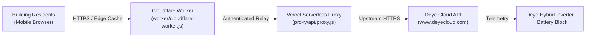

# Deye Inverter Real-Time Status & Blackout Monitor ⚡🔋

A lightweight, serverless monitoring system and public status page for **Deye** hybrid solar/battery inverters (tested on high-voltage 50 kW commercial installations and residential systems).

Provides building residents and property managers with a real-time, mobile-first dashboard showing grid availability, battery state-of-charge (SOC), dynamically computed autonomy forecasts, and an interactive blackout journal with detailed charts.

---

## 📸 Overview & Features

* **⚡ Real-Time Grid Status:** Instant detection of whether the building is powered by the municipal grid or running on battery backup.
* **🔋 Dynamic Autonomy Forecast:** Calculates remaining runtime based on real historical daytime (~4.8 kW) vs. nighttime (~2.8 kW) loads with a 15% battery safety buffer.
* **📊 Multi-Day Blackout Journal:** Tracks outages over the last 7 days, filtering out brief transient spikes and rendering interactive SVG charts with peak kW, average consumption, and kWh drained.
* **🛡️ Zero-Maintenance & Free-Tier Friendly:** Runs 100% serverless across Cloudflare Workers (edge compute) and Vercel (serverless relay).
* **🔒 Secure by Design:** No hardcoded tokens, passwords, or station IDs. All credentials are fully isolated in environment secrets.

---

## 🏗️ Architecture



### Why the Proxy Relay?
The upstream Deye Cloud API (`www.deyecloud.com`) is protected by AWS CloudFront WAF rules that frequently block Cloudflare edge IP ranges with `403 ACCESS IS BLOCKED`. The included Vercel Serverless Function serves as a clean, transparent pass-through proxy that forwards requests without triggering WAF blocks.

---

## 📁 Repository Structure

```
deye-inverter-status/
├── worker/                  # Cloudflare Worker status page & API
│   ├── cloudflare-worker.js # Main Edge Worker application
│   ├── wrangler.jsonc       # Cloudflare Wrangler configuration
│   ├── index.html           # Standalone static dashboard template
│   ├── chart.html           # Standalone telemetry visualization
│   └── .dev.vars.example    # Local secrets template
├── proxy/                   # Vercel Serverless WAF Bypass Relay
│   ├── api/
│   │   └── proxy.js         # Transparent Node.js proxy handler
│   ├── vercel.json          # Vercel routing configuration
│   └── package.json
├── local/                   # Optional local Python polling daemon
│   ├── updater.py           # Polling script for self-hosted mini-PCs
│   └── requirements.txt
├── .gitignore
├── LICENSE                  # MIT License
└── README.md
```

---

## 🚀 Quick Start & Deployment Guide

### Prerequisites
* A [Deye Cloud](https://www.deyecloud.com) account with your inverter added.
* A free [Cloudflare](https://dash.cloudflare.com) account.
* A free [Vercel](https://vercel.com) account.
* Node.js (v18+) installed locally.

---

### Step 1: Deploy the Vercel Proxy Relay

1. Navigate to the `proxy` directory:
   ```bash
   cd proxy
   ```
2. Deploy to Vercel:
   ```bash
   npx vercel --prod
   ```
3. Take note of your production URL (e.g., `https://your-proxy-name.vercel.app`).
4. Ensure **Deployment Protection** (SSO/Authentication) is disabled in your Vercel project settings so your Cloudflare Worker can reach it:
   ```bash
   npx vercel project protection disable <project-name> --sso
   ```

---

### Step 2: Deploy the Cloudflare Worker

1. Navigate to the `worker` directory:
   ```bash
   cd ../worker
   ```
2. Obtain your **Deye Cloud JWT Token** and **Station ID**:
   * Open [www.deyecloud.com](https://www.deyecloud.com) in your desktop browser and log in.
   * Open DevTools (`F12`), switch to the **Network** tab, and filter by `display`.
   * Find the `stationId` in the query parameters (e.g. `12345678`).
   * Find the `authorization` header in the request headers (starts with `Bearer eyJ...`).
3. Store your credentials in Cloudflare's encrypted secrets store:
   ```bash
   npx wrangler secret put DEYE_STATION_ID
   # Paste your Station ID when prompted

   npx wrangler secret put DEYE_TOKEN
   # Paste your Bearer JWT token when prompted

   npx wrangler secret put DEYE_API_BASE
   # Paste your Vercel URL, e.g. https://your-proxy-name.vercel.app
   ```
4. Deploy the Worker:
   ```bash
   npx wrangler deploy
   ```
5. Your dashboard is live! Open `https://<your-worker-name>.<your-subdomain>.workers.dev` in any browser.

---

### Local Development

To test the Cloudflare Worker locally:
1. Create a `.dev.vars` file inside the `worker/` directory:
   ```bash
   cp .dev.vars.example .dev.vars
   ```
2. Fill in your test credentials in `.dev.vars`.
3. Start the local development server:
   ```bash
   npx wrangler dev
   ```

---

## ⚙️ Configuration Variables

| Variable | Description | Where to Set |
| :--- | :--- | :--- |
| `DEYE_STATION_ID` | Numeric ID of your plant / station on Deye Cloud | `wrangler secret` or `.dev.vars` |
| `DEYE_TOKEN` | JWT Bearer token issued by Deye Cloud OAuth | `wrangler secret` or `.dev.vars` |
| `DEYE_API_BASE` | URL of the Vercel proxy relay (or direct Deye URL) | `wrangler secret` or `.dev.vars` |

---

## 📊 Telemetry API Endpoints

The Cloudflare Worker exposes machine-readable JSON endpoints for home automation integration (e.g., Home Assistant, Telegram bots):

* `GET /api/status` or `GET /status.json` — Returns live telemetry:
  ```json
  {
    "updated_at": "11:30",
    "is_grid_on": true,
    "battery_soc": 100,
    "battery_voltage": 648.9,
    "use_power_kw": 4.2,
    "charge_power_kw": 0.0,
    "est_hours_formatted": "8 – 14 год",
    "outages": [ ... ]
  }
  ```
* Append `?fresh=1` to bypass the 60-second CDN cache and force an immediate real-time fetch.

---

## 📄 License

This project is licensed under the [MIT License](LICENSE).
Feel free to adapt and use it for your residential complex, condominium, or personal solar setup.
